  

  
  
  
  

## About me

I'm a senior CS student at the **University of Florida** who loves building web apps that are fast, clean, and actually fun to use — usually with a coffee that's gone cold beside me.

- **Now:** leading a 5-engineer team on an RTX-sponsored capstone, building an offline AI system that turns NIST 800-53 controls into compliance requirements
- **Studying:** B.S. Computer Science (May 2027) + AI Fundamentals & Applications Certificate
- **Before:** backend work for UF's Open Source Club on a 110+ fork project
- **Looking for:** new grad software engineering roles for 2027

## 🏆 Featured work

**[GitFlow](https://github.com/hieunguyent12/shellhacks25)** &nbsp;·&nbsp; 1st at ShellHacks 2025 
Interactive dependency graphs for any GitHub repo

**[PowerLegal](https://github.com/Kavipatel0/KnightHacks)** &nbsp;·&nbsp; 2nd at KnightHacks 2025 
Four coordinated AI agents for legal case management

**[Fortnite Pathfinder](https://github.com/Kavipatel0/Fortnite-Pathfinder)** &nbsp;·&nbsp; 1st at the DSA Competition 
A* vs. Dijkstra's across 480,000+ hand-labelled cells

## 🧰 Toolbox

☕ Thanks for stopping by — <a href="mailto:kavipatel.jobs@gmail.com">say hi</a>.

